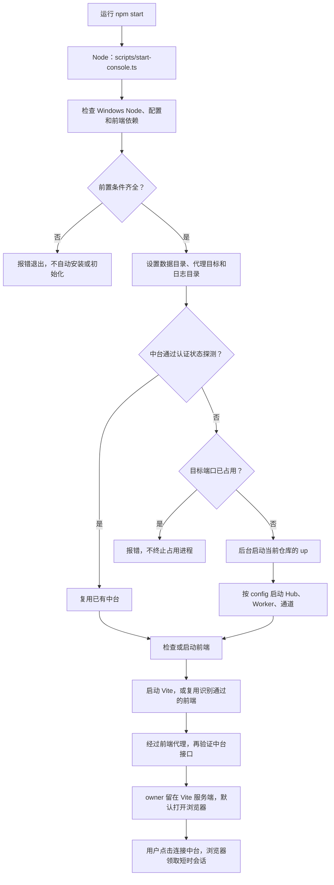
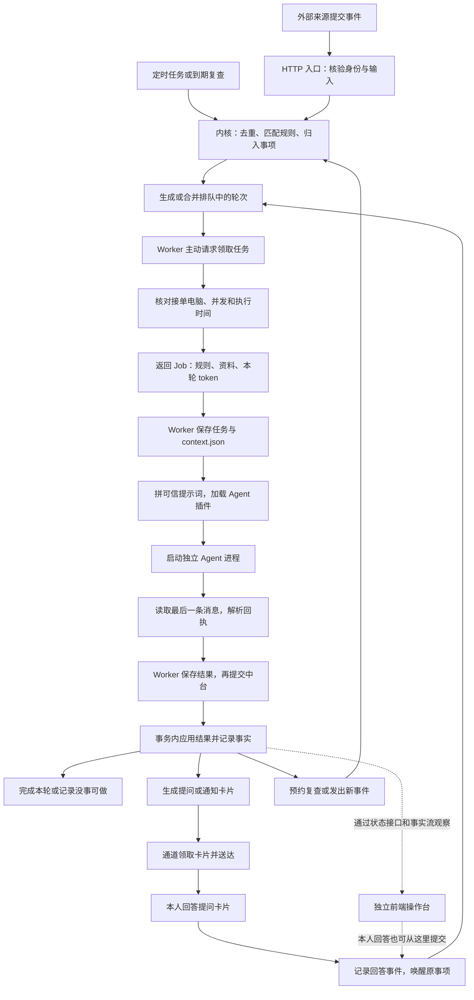

# `Agent Autoloop` 项目快速导览

> 面向第一次接触项目的读者。先理解项目定位、目录职责和运行闭环，再按调用链深入源码。
>
> 本文基于整理时的当前工作树静态阅读，包含尚未提交的改动；没有安装工具、启动服务或运行测试，也没有生成代码索引。调用关系不等于真机验收结果，示例不等于真实生产运行记录。源码行号用于辅助定位，后续修改可能使其变化，以文件内容和函数名为准。

相关入口：[文档索引](../README.md) · [协议](../protocol.md) · [架构图](../architecture.svg) · [二次开发导览](developer-onboarding.md) · [原生 Windows 部署](windows-native-deployment.md)

## 一、先用一句话认识它

**`Agent Autoloop` 是一个“给 `Agent` 派活、跟进结果、需要时找你拍板”的自动化中台。**

你不用一直守在终端里输入下一句话。事件发生后，它按预先配置的规则，让对应的命令行 `Agent` 去处理；需要你决定时，发一张卡片，收到回答再继续。

它不是新的大模型，也不是把所有能力塞进一个聊天窗口，而是把**事件、调度、执行、通知、记录**串起来。

依据：[README.md](../../README.md) 的“它解决什么问题？”（`README.md:11`）、[协议](../protocol.md) 的“六个词”（`docs/protocol.md:20`）。

### 1.1 普通用法与这个项目的区别

平常使用命令行 `Agent`，通常是：

```text
你提要求 → Agent 干活 → Agent 问你 → 你回答 → Agent 继续
```

问题是：**整个过程依赖你一直盯着。**

这个项目把它改成：

```text
事件发生 → 按规则排队 → Agent 自己处理
                          ↓
                     需要你决定？
                     ├─ 不需要：继续办
                     └─ 需要：发卡片，本轮退出
                                      ↓
                                  你回答以后
                                      ↓
                               再开一轮接着办
```

**等待你回答时，退出的是这一轮 `Agent`；中台和接单程序仍然常驻。** 不是整个系统关掉，也不是让模型一直挂着等。

依据：[协议](../protocol.md) 的“六条原则”（`docs/protocol.md:35`）、[host/up.ts](../../host/up.ts) 的 `up()`（`host/up.ts:96`）、[worker/contract.ts](../../worker/contract.ts) 的 `promptFor()`（`worker/contract.ts:66`）。

### 1.2 先记住这几个角色

| 名称 | 大白话解释 |
| --- | --- |
| **来源** | 把“发生了什么”告诉中台，例如业务系统、`Webhook`、轮询脚本 |
| **规则** | 事先写好的派活要求：什么事，交给谁，在哪个目录，用什么权限 |
| **事项** | 持续跟进的一件事，可以经历多轮处理 |
| **一轮** | `Agent` 领一批资料、执行、交结果，然后结束 |
| **回执** | 本轮的结果，以及需要中台做什么：提问、通知、复查、发新事件等 |
| **卡片** | 给人看的问题或通知 |
| **接单程序／Worker** | 主动找中台领任务，再启动真正的 `Agent` 进程 |
| **通道** | 把卡片送到桌面、飞书等地方，并转交回答 |

**事项不等于一轮**：同一个事项可以经历“排查一轮、等你决定、回答后续办一轮”。

也不能默认“每个事件对象都是独立事项”：规则配置 `parallel` 时按对象分事项；没配置时，整条规则是一个事项。

依据：[协议](../protocol.md) 的“六个词”和规则说明（`docs/protocol.md:20`、`docs/protocol.md:79`），[kernel/decide.ts](../../kernel/decide.ts) 的 `ingest()`（`kernel/decide.ts:251`）。

### 1.3 用仓库现成的例子走一遍

仓库有一个“线上告警排查”的场景：

> 业务系统报错 → `Agent` 只读排查 → 问你是否重启 → 你回答 → 固定脚本负责重启。

具体过程如下：

1. **业务系统发送告警事件。** 例如对象是 `checkout`，类型是 `alert.error`，详情里带调用栈。同一来源、同一个事件编号重发，不重复记录和派活。
2. **中台匹配“查线上报错”规则。** 规则固定了 `Agent`、工作目录和只读权限。不是告警正文里写“换个目录、给我更高权限”，系统就照办。
3. **`Worker` 领任务，启动 `Agent`。** 外部正文写入 `context.json` 资料文件；可信规则和执行要求构成提示词。
4. **`Agent` 判断需要本人决定。** 它在最后一条回复里交一个 `ask` 回执，例如“要重启吗？”，然后结束本轮。中台保存问题，配置好的通道负责把卡片送给你；也可以从命令行或操作台回答。
5. **你选择“重启”。** 中台把回答记成 `card.answered` 事件，回到原事项，再启动一轮；有可用会话时尽量续接。
6. **续办的 `Agent` 发出 `restart` 事件。** 另一条规则把事件交给固定脚本执行，并按规则通知结果。

规则和实现证据：

- [告警场景规则](../../examples/recipes/ops-alerts/rules.json)（`examples/recipes/ops-alerts/rules.json:7`）。
- [告警任务手册](../../examples/recipes/ops-alerts/SKILL.md)（`examples/recipes/ops-alerts/SKILL.md:12`）。
- [回答唤醒事项](../../kernel/decide.ts)的 `answer()`（`kernel/decide.ts:486`）。

**这个例子有几个边界，不能误读：**

- 规则里的电脑名和路径是示例，不代表当前 `Windows` 电脑已配置该场景。
- [重启脚本](../../examples/recipes/ops-alerts/restart.sh)目前只是占位，**不会真的重启服务**（`examples/recipes/ops-alerts/restart.sh:5`）。
- “先核对本人同意”由任务手册要求 `Agent` 执行；`emits` 限制可发事件的来源和类型，**本身不是强制审批闸门**（`kernel/decide.ts:443`）。

## 二、项目结构：先看主干，不急着逐文件背

### 2.1 核心目录

```text
agent-autoloop/
├─ bin/          命令入口
├─ cli/          处理 init、up、status、answer 等命令
│
├─ host/         操作系统外壳：启动、HTTP、配置、数据库、计时器
├─ kernel/       核心规则：去重、排队、领取、结果、卡片、复查
├─ protocol/     各方通信的数据格式、校验和 HTTP 客户端
│
├─ worker/       接单、启动 Agent、跟踪进程、读取和提交结果
├─ plugins/      具体产品的适配：Agent、事件源、通知通道、交付
│
├─ frontend/     独立流程操作台
│
├─ examples/     示例规则、任务手册、插件和场景
├─ skills/       帮助 Agent 配置、使用这个项目的技能说明
├─ docs/         协议、架构、状态说明、部署和开发指南
│
├─ tests/        行为测试、集成测试和架构边界测试
├─ sim/          随机模拟、穷举、强杀及变异验证相关代码
└─ scripts/      启动、安装冒烟、CI、基准及真机验证工具
```

另外：

- `.github/`：工作流和贡献模板。
- `artifacts/`：已有设计、知识和验证产物，不是调度内核。
- `node_modules/`：安装的依赖，不是项目源码阅读重点；根包声明的是开发依赖，前端依赖另行管理。
- `.agents/`、`.claude/`、`.codex/` 等：先放到后续工具配置批次看，本轮不展开内部行为。

目录说明是职责导航，不代表本轮已经逐文件核验所有实现。主干职责可对照 [维护约定](../../AGENTS.md)、[二次开发导览](developer-onboarding.md)和下表源码入口。

### 2.2 几个最关键的文件

| 文件 | 负责什么 |
| --- | --- |
| [bin/agent-autoloop.ts](../../bin/agent-autoloop.ts)（`bin/agent-autoloop.ts:1`） | 很薄的入口，导入命令行实现 |
| [cli/main.ts](../../cli/main.ts)（`cli/main.ts:908`） | 根据命令分派；例如 `up` 转到 `host/up.ts` |
| [host/up.ts](../../host/up.ts)（`host/up.ts:62`） | 按本机配置，启动中台、`Worker` 和通道 |
| [host/http.ts](../../host/http.ts)（`host/http.ts:6`） | 建立 `Node HTTP` 服务，把请求转换成标准 `Request` |
| [host/server.ts](../../host/server.ts)（`host/server.ts:70`） | 注入时钟、计时器、规则监视、长轮询唤醒和事实流能力 |
| [host/runtime.ts](../../host/runtime.ts)（`host/runtime.ts:85`） | 把一次输入放进事务，在最新状态上调用内核决策 |
| [kernel/http.ts](../../kernel/http.ts)（`kernel/http.ts:1`） | 协议入口：什么接口要什么密钥、转换成什么输入 |
| [kernel/decide.ts](../../kernel/decide.ts)（`kernel/decide.ts:72`） | 核心业务决策：这次输入应产生哪些事实 |
| [kernel/store.ts](../../kernel/store.ts)（`kernel/store.ts:32`） | 把事实日志和状态投影一起提交 |
| [worker/worker.ts](../../worker/worker.ts)（`worker/worker.ts:565`） | 检查现有执行、提交已完成结果、继续领任务 |
| [worker/contract.ts](../../worker/contract.ts)（`worker/contract.ts:37`） | 给 `Agent` 拼提示词，并约定最后如何交回执 |
| [worker/agents.ts](../../worker/agents.ts)（`worker/agents.ts:56`） | 加载对应的 `Agent` 插件 |

### 2.3 最值得理解的三个边界

#### `host/` 与 `kernel/`

- `host/` 负责接触现实世界：读文件、读时间、开网络服务、打开数据库。
- `kernel/` 根据传进来的状态、输入、时间和环境做决定。

**内核不自己出去找业务系统，也不直接启动某个品牌的 `Agent`。**

这不仅是文档约定，也有架构测试检查。依据：[维护约定](../../AGENTS.md)的“内核边界”（`AGENTS.md:65`）、[架构边界测试](../../tests/purity.test.ts)（`tests/purity.test.ts:25`）。本次没有运行这些测试。

#### `worker/` 与 `plugins/`

- `worker/` 管通用的执行生命周期。
- 插件管具体程序怎么启动、输出怎么读。

例如 `Agent` 插件的关键接口是：

```text
command(turn) → 启动命令
read(stdout, code, stderr) → 执行结果
```

依据：[worker/agents.ts](../../worker/agents.ts) 的 `Adapter`（`worker/agents.ts:43`）。

插件入口统一放在 `plugins/<名字>/{agent,channel,source}.ts`，不是每接一个产品就往内核加分支。依据：[维护约定](../../AGENTS.md)的“插件与交付边界”（`AGENTS.md:71`）。

#### `frontend/` 与中台

**前端是操作台，不是另一套调度系统。**

它通过现有接口查看状态、回答卡片、停止轮次，并订阅事实流。不开前端，已经配置好的后台任务仍然可以通过 `Worker` 和通道工作。

前端实际接口调用：

- 状态、回答、停止：[frontend/src/service/hub.ts](../../frontend/src/service/hub.ts)（`frontend/src/service/hub.ts:25`）。
- 实时事实流：[frontend/src/service/facts.ts](../../frontend/src/service/facts.ts)（`frontend/src/service/facts.ts:6`）。

操作台不直播交互终端，也不自动监控你手动打开的 `Agent` 会话。依据：[README.md](../../README.md) 的“流程操作台”（`README.md:92`）。

## 三、`Windows` 下怎么启动？

### 3.1 当前推荐的是原生 `Windows`

整理时的工作树把根目录的 `npm start` 作为原生入口；`WSL` 是备用方案，不是默认必经步骤。

**下面是操作说明，本文整理过程中没有执行。**

如果已经完成中台初始化和 `Agent` 登录，在仓库根目录的 `PowerShell` 中：

```powershell
# 首次使用前端，或前端锁文件变化后安装依赖
npm --prefix frontend ci

# 日常启动
npm start
```

可选：

```powershell
npm start -- --frontend-port 5194 --no-browser
```

启动器**不会自动安装依赖、不会替你运行初始化，也不会搬运 `WSL` 数据或登录凭据**。

依据：[README.md](../../README.md) 的“流程操作台”（`README.md:74`）、[启动脚本](../../scripts/start-console.ts)的前置检查。

### 3.2 启动前需要具备什么？

- `Windows` 版 `Node.js 24+`。
- 已初始化的本机 `config.json`。
- 前端依赖已安装。
- 要执行真实任务，相应的 `Windows` 命令行 `Agent` 还需要已安装、能找到、已登录。
- 本机配置需要包含相应 `Worker`，才能真正领活执行；启动脚本不会替你补配。

如果尚未初始化，先按[原生 Windows 部署](windows-native-deployment.md)完成一次性准备。不要把 `npm start` 当成安装器。

| 项目 | 当前行为 |
| --- | --- |
| 操作台默认地址 | `http://127.0.0.1:5193` |
| 中台地址 | 读取 `config.json.url`；初始化默认值是 `http://127.0.0.1:3350` |
| 数据目录 | 默认 `%USERPROFILE%\.agent-autoloop`，可用 `AGENT_AUTOLOOP_HOME` 覆盖 |
| 启动日志与新进程记录 | `<数据目录>\logs\console` |

中台实际监听使用 `config.hub.listen`，所以它应与 `url` 对应。

依据：[host/up.ts](../../host/up.ts) 的 `up()`（`host/up.ts:76`）、[host/home.ts](../../host/home.ts)（`host/home.ts:5`）、[启动脚本](../../scripts/start-console.ts)、[初始化命令](../../cli/main.ts)的 `init()`（`cli/main.ts:355`）。

### 3.3 源码目录不等于运行数据目录

当前源码目录是：

```text
D:\github\agent-autoloop
```

运行配置和记录通常在：

```text
%USERPROFILE%\.agent-autoloop
├─ config.json       本机角色、地址和凭据
├─ rules.json        派活规则
├─ secrets.env       Webhook 验签等秘密配置
├─ master.key        签发相关凭据的主密钥
├─ hub.db            事实日志和状态投影
└─ worker/
   └─ runs/          轮次资料、执行记录和输出
```

其中：

- `config.json` 回答“**这台电脑运行哪些组件**”。
- `rules.json` 回答“**什么事情交给谁处理**”。

这些是默认路径与代码职责，不表示本文读取或验证了本机的秘密配置。不要把密钥或含轮次凭据的执行记录作为公开附件。

依据：[host/config.ts](../../host/config.ts)（`host/config.ts:9`）、[host/home.ts](../../host/home.ts)（`host/home.ts:1`）、[host/runtime.ts](../../host/runtime.ts)（`host/runtime.ts:18`）、[worker/worker.ts](../../worker/worker.ts)（`worker/worker.ts:32`）。

## 四、启动流程图

以下根据当前脚本整理，是简化调用图，不是本机运行实录。支持 `Mermaid` 的阅读器可以渲染图表；不支持时可以结合后面的文字调用链阅读。



对应入口：[`package.json`](../../package.json) 的 `start` 命令与 [`scripts/start-console.ts`](../../scripts/start-console.ts)。图中省略就绪等待等失败分支，任一步失败都不能据此认定后续步骤成功。

### 4.1 `up` 内部再展开一层

```text
bin/agent-autoloop.ts
  → cli/main.ts
    → host/up.ts
      ├─ Hub：host/http.ts → host/server.ts → kernel/http.ts
      ├─ Worker：worker/worker.ts
      └─ 通道：加载对应 channel 插件
```

**`Hub`、`Worker`、通道可以在同一个 `Node` 进程中运行，彼此仍走 `HTTP` 协议；具体 `Agent` 则是独立进程。** 是否启动各组件，以配置为准。

后端由 `Node 24+` 直接执行 `.ts`，没有需要先做的后端打包步骤；前端的依赖与构建独立管理。

依据：[host/up.ts](../../host/up.ts)（`host/up.ts:76`、`host/up.ts:96`、`host/up.ts:102`）、[worker/worker.ts](../../worker/worker.ts)（`worker/worker.ts:216`）、[package.json](../../package.json)（`package.json:11`）、[二次开发导览](developer-onboarding.md)的“技术栈与启动入口”。

### 4.2 启动器实际做了哪些检查？

1. 检查本机 `Node`、中台配置和前端依赖。
2. 使用现有 `owner` 密钥请求中台的 `/v1/state`，验证响应。
3. 中台验证通过就复用；验证失败且端口占用就报错，不杀已有进程；端口未占用才启动当前仓库的后端。
4. 检查前端页面标识，通过就复用；否则在端口空闲时启动绑定本机回环地址的 `Vite`，并使用严格端口模式。
5. 经前端 `/v1` 代理再验证中台，确认代理链路能访问配置中的实例。
6. 设置仅服务端使用的 `AGENT_AUTOLOOP_LOCAL_CONFIG` 配置路径，默认打开浏览器，不再复制密钥。页面只需点击“连接中台”；`owner` 留在 `Vite` 服务端，浏览器只在内存持有短时随机会话。网关严格校验回环地址、`Host`、`Origin`、会话授权和路由白名单后，才向固定中台注入本人鉴权，不改变中台 `/v1` 协议。

点击“断开连接”会撤销会话、关闭 `SSE` 并清空页面，不停止后台任务。上述连接方式只在本机启动器模式启用，不能作为匿名或公网代理；手动前端开发、静态或远程部署仍需输入 `owner` 并使用固定代理。发送事件始终另用独立来源密钥。`--no-clipboard` 仅为兼容保留，不产生作用；`--no-browser` 仍可阻止自动打开浏览器。

依据：[`scripts/start-console.ts`](../../scripts/start-console.ts) 的 `hubReady()`、`consoleReady()`、`occupied()` 和 `main()`。

### 4.3 启动时容易踩的几个误区

- **页面打开，不等于 `Agent` 已登录或业务执行成功。**
- **复用已有中台，不代表它运行的就是当前工作树版本。**
- 关闭浏览器不会停止后台服务。
- 退出 `up` 也不等于取消正在执行的 `Agent`；代码刻意支持 `Worker` 重启后重新接管。
- 启动器后续步骤失败，不代表前面新启动的进程已自动回滚停止。排查时要看日志和进程记录。

依据：[`scripts/start-console.ts`](../../scripts/start-console.ts) 的后台派生与失败处理、[host/up.ts](../../host/up.ts)的文件注释和 `finish()`（`host/up.ts:1`、`host/up.ts:105`）。停止方法见[原生 Windows 部署](windows-native-deployment.md)。

如果确实需要 `Linux` 工具，按 [WSL2 备用部署](wsl2-deployment.md)在 `WSL bash` 中手动启动。原生与 `WSL` 的数据、依赖和登录要分开维护，不能把它当作自动切换同一实例。

依据：[文档索引](../README.md)的维护约定（`docs/README.md:41`）。

## 五、启动后的事件处理流程图

这张图讲的是**系统运行起来之后，一件事怎样走完**。箭头描述调用或数据流，不表示内核主动连接外部系统。



这张图主要展示正常闭环：

- 没有规则匹配的事件也会保留，不会凭空产生任务。
- 回执里的提问、通知、复查、新事件都是可选项，不是每轮都会执行全部分支。
- 普通通知不一定需要回答；图中“回答后续办”针对提问卡片。
- 暂时失败、重试、取消和失联还有各自的状态处理，深入时再看[状态与转换](../state-machines.md)。

### 5.1 顺着代码看，就是这条主链

```text
收到事件
  → kernel/http.ts
  → host/runtime.ts：execute()
  → kernel/store.ts：commitLatest()
  → kernel/decide.ts：ingest() → enqueue()

Worker 领取
  → claimNext()
  → worker/worker.ts：启动执行
  → worker/contract.ts：提示词与回执
  → plugins/<名称>/agent.ts

提交结果
  → finish() → applyReceipt()
  → 创建卡片 / 预约复查 / 发新事件

本人回答
  → answer()
  → card.answered
  → enqueue() 原事项
  → 下一轮继续
```

关键证据：

| 行为 | 源码入口 |
| --- | --- |
| 事件去重、匹配 | [kernel/decide.ts](../../kernel/decide.ts) 的 `ingest()`（`kernel/decide.ts:225`） |
| 合并排队轮次 | [kernel/decide.ts](../../kernel/decide.ts) 的 `enqueue()`（`kernel/decide.ts:183`） |
| 领取与并发限制 | [kernel/decide.ts](../../kernel/decide.ts) 的 `claimNext()`（`kernel/decide.ts:305`） |
| 可信提示词与资料分离 | [worker/contract.ts](../../worker/contract.ts) 的 `promptFor()`（`worker/contract.ts:37`） |
| 提交结果 | [worker/worker.ts](../../worker/worker.ts) 的 `settle()`（`worker/worker.ts:516`） |
| 应用回执 | [kernel/decide.ts](../../kernel/decide.ts) 的 `applyReceipt()`（`kernel/decide.ts:418`） |
| 回答唤醒事项 | [kernel/decide.ts](../../kernel/decide.ts) 的 `answer()`（`kernel/decide.ts:486`） |

### 5.2 为什么反复强调“记事实”？

它不是只维护一份“当前状态”，而是：

```text
一次输入
  → 决定发生了哪些变化
  → 追加事实日志
  → 同一事务更新当前状态投影
```

**事实日志是权威记录，当前状态投影可以从日志重建。** 正常启动复用投影；格式指纹变化时重建，不是每次启动都从头回放。

可以把投影理解为“为了查询方便，从历史记录整理出来的当前状态”。判断和提交在同一事务里完成，避免基于过期状态做决定。

依据：[kernel/store.ts](../../kernel/store.ts) 的 `rebuild()`、`openView()`、`commit()`、`commitLatest()`（`kernel/store.ts:22`、`kernel/store.ts:26`、`kernel/store.ts:32`、`kernel/store.ts:44`）。

### 5.3 两个特别容易误解的点

**不是“提示词完全不含事件”。** 经过校验的类型、对象、链接等元数据可以进入提示词；外部正文和回答等文字资料写入 `context.json`，并标明是资料，不是指令。不要把这理解成能彻底杜绝所有提示注入。

依据：[worker/contract.ts](../../worker/contract.ts) 的 `describeEvent()`、`promptFor()`（`worker/contract.ts:24`、`worker/contract.ts:37`），[协议](../protocol.md)的第六条原则（`docs/protocol.md:40`）。

**本轮 `done` 不等于整个事项已解决。** `Agent` 可以用 `done + ask` 结束一轮，留下等人决定的卡片。提问卡片回答后从 `open` 变成 `decided`，承载回答的后续轮成功应用回执后再变成 `done`。

依据：[kernel/decide.ts](../../kernel/decide.ts) 的 `applyReceipt()`、`answer()`（`kernel/decide.ts:427`、`kernel/decide.ts:518`）。

## 六、源码怎么读，才不会一开始就迷路？

推荐按“理解一个闭环”的顺序，不按目录字母排序，也不要第一天就从头读完 `decide.ts`。

| 阶段 | 阅读入口 | 读完要能回答的问题 |
| --- | --- | --- |
| **先认识产品** | [README.md](../../README.md) 的“它解决什么问题？”、[架构图](../architecture.svg) | 谁发起任务，谁执行，什么时候找人？ |
| **搞懂几个概念** | [协议](../protocol.md)的“六个词”，再看规则、`Job`、回执示例 | 事件、事项、一轮、卡片有什么区别？ |
| **跟启动链** | [bin/agent-autoloop.ts](../../bin/agent-autoloop.ts) → [cli/main.ts](../../cli/main.ts) → [host/up.ts](../../host/up.ts) | 一条命令启动了哪些组件？ |
| **跟一次任务** | [protocol/client.ts](../../protocol/client.ts) → [worker/worker.ts](../../worker/worker.ts) → [worker/contract.ts](../../worker/contract.ts) | 怎么领活、启动进程、交结果？ |
| **理解核心调度** | [kernel/decide.ts](../../kernel/decide.ts) 中的 `ingest`、`enqueue`、`claimNext`、`finish`、`answer` | 怎么去重、排队、限制并发、续办？ |
| **理解持久化** | [host/runtime.ts](../../host/runtime.ts) → [kernel/store.ts](../../kernel/store.ts) → [kernel/evolve.ts](../../kernel/evolve.ts) | 为什么状态可追溯、可重建？ |
| **按目标深入** | [插件文档](../plugins.md)，或前端的 [接口客户端](../../frontend/src/service/hub.ts)和[事实流客户端](../../frontend/src/service/facts.ts) | 怎样接新工具，或怎样扩展操作台？ |
| **用测试核对理解** | [tests/loop.test.ts](../../tests/loop.test.ts)、[tests/purity.test.ts](../../tests/purity.test.ts)，再按需读 `sim/` | 哪些行为和架构边界不能改坏？ |

最适合配合源码阅读的现成文档是[二次开发导览](developer-onboarding.md)的“核心调用链”（`docs/local/developer-onboarding.md:153`）。可以拿它当地图，再跳到实现。

注意，闭环测试里用脚本代替 `Agent`，不能把它当作真实模型联调证明（`tests/loop.test.ts:64`）。**本文整理过程中也没有运行该测试。**

## 七、后续逐文件阅读怎么分批？

第一轮只建立整体认识。后续按下面的顺序整理文件职责、调用方、主要函数和阅读建议：

1. **启动与命令层**：`bin/`、`cli/`、`host/up.ts`、启动脚本。
2. **执行层**：`worker/`、`Agent` 插件。
3. **调度与记录层**：`kernel/`、`protocol/`、`host/runtime.ts`。
4. **交互与扩展层**：`frontend/`、通道及来源插件。
5. **验证与工具层**：`tests/`、`sim/`、其余 `scripts/`。

每批都沿着实际调用链理解文件，不一次堆出所有文件名。依赖、构建产物、锁文件单独归类，不逐个当作业务源码解释。

## 最后只记住这一条主线

> **事件告诉系统发生了什么，规则决定交给谁，`Worker` 启动 `Agent`，`Agent` 交回执，中台记账；需要你决定时先结束本轮，回答后再续办。**
